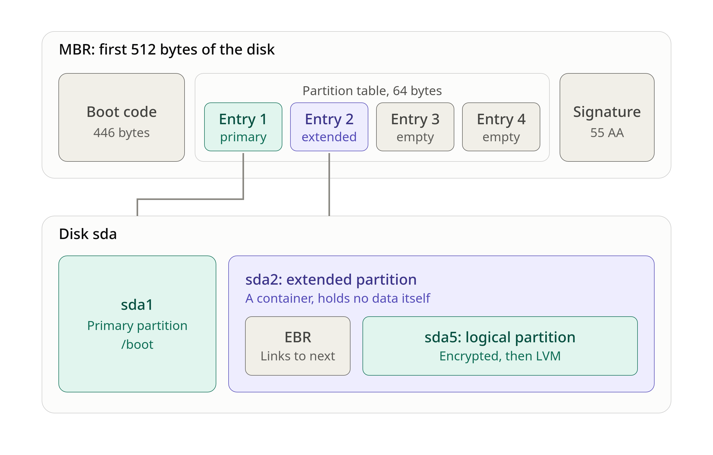

# Table of content
- [Mandatory](#mandatory)
  - [What Is Virtual Machine](#what-is-virtual-machine)
    - [Why Virtual Machine](#why-virtual-machine)
    - [Are Virtual Machines Used for Long or Short Term?](#are-virtual-machines-used-for-long-or-short-term)
  - [Disk Size](#disk-size)
    - [How Does the Industry Decide Disk Size](#how-does-the-industry-decide-disk-size)
    - [What Should We Do](#what-should-we-do)
    - [Commands That Help in Disk and Partition Checking](#commands-that-help-in-disk-and-partition-checking)
    - [The Directory Needed](#the-directory-needed)
    - [The Difference Between SI Units and IEC Units](#the-difference-between-si-units-and-iec-units)
  - [Hostname](#hostname)
    - [Naming Rules](#naming-rules)
    - [How to View Your Hostname](#how-to-view-your-hostname)
    - [What Is the Difference Between Static, Transient and Pretty Hostnames](#what-is-the-difference-between-static-transient-and-pretty-hostnames)
    - [How to Change Hostname](#how-to-change-hostname)
  - [What Is Logical Volume Manager (LVM)?](#what-is-logical-volume-manager-lvm)
    - [The Problem LVM Solves](#the-problem-lvm-solves)
    - [The 3 Layers of LVM](#the-3-layers-of-lvm)
    - [Useful Commands for LVM Checking](#useful-commands-for-lvm-checking)
  - [Linux Boot Process](#linux-boot-process)
    - [What Is Master Boot Record (MBR)](#what-is-master-boot-record-mbr)
    - [What Is /boot](#what-is-boot)
      - [Why /boot Is a Separate Partition From Encrypted Partition](#why-boot-is-a-separate-partition-from-encrypted-partition)
      - [Useful Command Related to /boot](#useful-command-related-to-boot)
  - [Debian Vs Rocky](#debian-vs-rocky)
  - [apt Vs aptitude](#apt-vs-aptitude)
    - [Main Differences Between apt and aptitude](#main-differences-between-apt-and-aptitude)
  - [AppArmor](#apparmor)
    - [Useful Command to Check AppArmor](#useful-command-to-check-apparmor)
  - [Sudo](#sudo)
    - [Sudo Installation](#sudo-installation)
    - [Configure Sudoers](#configure-sudoers)
      - [Path to Configure](#path-to-configure)
      - [Rules to Configure](#rules-to-configure)
  - [User](#user)
    - [Where User Information Is Stored](#where-user-information-is-stored)
    - [How to Add User](#how-to-add-user)
    - [How to Delete a User](#how-to-delete-a-user)
  - [Groups](#groups)
    - [Where Groups Are Stored](#where-groups-are-stored)
    - [Commands to Look at Groups](#commands-to-look-at-groups)
    - [Commands to Change Groups](#commands-to-change-groups)
    - [To Add Group user42](#to-add-group-user42)
    - [Assign User to Sudo and user42 Group](#assign-user-to-sudo-and-user42-group)
  - [User Password](#user-password)
    - [/etc/login.defs](#etclogindefs)
      - [Configure Password Aging Controls Rules](#configure-password-aging-controls-rules)
      - [Change Password Aging Controls to Existing User](#change-password-aging-controls-to-existing-user)
    - [libpam-pwquality](#libpam-pwquality)
      - [libpam-pwquality Installation](#libpam-pwquality-installation)
      - [Configure Password Rules](#configure-password-rules)
      - [Change Current User's Password](#change-current-users-password)
  - [Network](#network)
    - [Port](#port)
      - [Terms](#terms)
      - [The Ranges of Port](#the-ranges-of-port)
      - [Common Ports Worth Recognizing](#common-ports-worth-recognizing)
      - [Command to See Port](#command-to-see-port)
    - [TCP and UDP](#tcp-and-udp)
    - [IPv4 & IPv6](#ipv4--ipv6)
      - [IPv4](#ipv4)
      - [IPv6](#ipv6)
    - [NAT](#nat)
      - [Terms Related to NAT](#terms-related-to-nat)
  - [SSH](#ssh)
    - [Configure SSH](#configure-ssh)
      - [Differences Between SSHD Config Files](#differences-between-sshd-config-files)
      - [Config SSHD](#config-sshd)
      - [Checking SSHD Config](#checking-sshd-config)
    - [Connect to VM SSH](#connect-to-vm-ssh)
      - [The Meaning VirtualBox Port Forwarding Fields](#the-meaning-virtualbox-port-forwarding-fields)
      - [Steps to Connect](#steps-to-connect)
  - [UFW](#ufw)
    - [UFW Installation](#ufw-installation)
    - [Allow Port and Enable UFW](#allow-port-and-enable-ufw)
    - [Useful Commands for UFW](#useful-commands-for-ufw)
  - [Cron](#cron)
    - [Command to Check the Cron Manual](#command-to-check-the-cron-manual)
    - [Cron Rules](#cron-rules)
      - [Special Symbols and Examples:](#special-symbols-and-examples)
    - [How to Set Up Cron](#how-to-set-up-cron)
      - [Option A: Root’s Crontab](#option-a-roots-crontab)
        - [Other Crontab Commands:](#other-crontab-commands)
      - [Option B: System Files /etc/cron.d (Optional)](#option-b-system-files-etccrond-optional)
    - [Checking Whether Cron Is Active](#checking-whether-cron-is-active)
    - [Interrupt Cron](#interrupt-cron)

# Mandatory

## What Is Virtual Machine
A VM is a pretend computer running as a program inside a real computer. It has its own virtual CPU, RAM, disk and network card, and its own OS, but all of these are carved out of the real hardware.

- *Host*: the real physical computer (your real computer).
- *Guest*: the VM running inside it (your Debian, Rocky or another server).
- *Hypervisor*: the software that creates and manages VMs. It divides the host’s real resources among them and keeps them isolated from each other.

### Why Virtual Machine
- *Cost and efficiency*: One powerful physical server can run 10-50 VMs.
- *Isolation*: If one VM crashes or gets hacked, the others are not directly affected.
- *Flexibility*: You can create a VM in minutes, clone it, move it between physical machines, or delete it.
- *Safe testing*: You can break things freely, then use a snapshot (a saved state) to roll back.
- *Cloud computing*: When you rent a server from AWS, Google Cloud or Azure, you are renting a VM.

### Are Virtual Machines Used for Long or Short Term?
| Use case | Lifespan |
|---|---|
| Production servers (websites, databases, company apps) | Months to years, running 24/7 |
| Development and testing environments | Days to weeks |
| Learning and training (like Born2beRoot) | Short term |
| Security testing, malware analysis | Hours to days, then deleted |
| Auto-scaling cloud servers | Minutes to hours, created and destroyed automatically |

> One caveat on current practice: for many modern applications, companies now use containers (Docker, Kubernetes), which are lighter than VMs. VMs are still very widely used, and containers often run inside VMs, so VMs remain a core skill.

---

## Disk Size
### How Does the Industry Decide Disk Size
- *Know the workload*: a small web server needs far less than a database holding millions of records.
- *Add up the parts*: OS footprint + applications + data + logs + temporary files + swap.
- *Estimate growth*: How much will data and logs grow per month? Plan for 1-3 years, not just today.
- *Add headroom*: A common rule of thumb is to keep 20-30% free. A disk that hits 100% can crash services.
- *Separate by purpose*: This is why the bonus asks for `/var`, `/var/log`, `/tmp` and `/home` as separate partitions. If logs fill up, they only fill their own partition instead of freezing the whole system.
- *Monitor and adjust*: Teams use monitoring tools with alerts (for example at 80% full), then expand when needed.

### What Should We Do
1. *Install first, measure second*. Do a trial install and run `df -h`. The “Used” column tells you what the system needs, instead of a guess.
2. *Add the services*. Use `apt-get install -s` on your bonus packages (lighttpd, mariadb-server, php) to see their size.
3. *Add expected data*. For example, how large will the WordPress site and database get?
4. *Add headroom*. Keep roughly *20-30% free*, because a full partition can break services.
5. *Check the total fits your disk*. The partition sizes must add up to your disk size, minus `/boot`.

### Commands That Help in Disk and Partition Checking
| Command | What it shows |
|---|---|
| `lsblk` | Partitions and logical volumes, and their sizes |
| `df -h` | For each mounted partition: size, used, available, and % used |
| `du -sh /*` | How big each top-level folder is (run as root, ignore errors) |
| `du -sh /var/* \| sort -h` | What is eating space inside `/var` |
| `apt-get install -s <package>` | A simulation that shows how much extra disk a package would use, without installing it |

### The Directory Needed
Each directory holds a different kind of data. Sizing depends on what goes in it and how fast it grows.
| Directory | What it holds | Grows over time? | How to decide the size |
|---|---|---|---|
| `/boot` | Files needed to start the OS (kernel, bootloader). Unencrypted. | Slowly, as kernel updates add files | About 500 MB is the standard. Too small and kernel updates fail. |
| `/` (root) | The OS itself: programs, libraries, configuration | Slowly | System size (see above) plus apps you install, plus headroom |
| `/home` | Each user's personal files | Depends on users | Number of users × expected data each. For a server with 1-2 users, a few GB is plenty. |
| `/var` | Data that changes constantly: package database, apt cache, mail, **databases (MariaDB stores data in `/var/lib/mysql`)** | Yes | Depends on what services run. WordPress with MariaDB needs far more than a bare server. |
| `/var/log` | Log files recording what the system does | Yes, steadily | Sized for how many days of logs you want to keep. Separate so runaway logs can't fill the whole system. |
| `/srv` | Data served by your services (for example website files) | Depends | Size of the content you plan to host |
| `/tmp` | Temporary files, usually cleared on reboot | Spikes | Small is fine, 1-3 GB |
| `/root` | The **root user's** home folder | Barely | Normally **not a separate partition**. It lives inside `/`, so the PDF layouts have no `/root` entry. |
| `swap` | Overflow space used when RAM is full | No | A common rule for small VMs is about equal to RAM |

### The Difference Between SI Units and IEC Units
Both measure amounts of data, but they count in different ways:
- `GB`, `MB`, `KB` *(SI units)*: count in powers of 10. Each step is ×1000.
- `GiB`, `MiB`, `KiB` *(IEC units)*: count in powers of 2. Each step is ×1024.

### Disk Size Recommented

| Area | Current size | Used | Size Recommented |
|---|---|---|---|---|---|
| `/boot` | 499M | 140M | **500M** |
| `/` | 10G | 1.1G | **4G** |
| swap | 2.3G | 0 | **1G** |
| `/home` | 5G | 1.4M | **2G** |
| `/var` | 3G | 547M | **2G** |
| `/var/log` | 4G | 49M | **1G** |
| `/srv` | 3G | 792K | **1G** |
| `/tmp` | 3G | 35M | **1G** |
| extra |     |     |    **2G**    |

---

## Hostname
A hostname is the name of a computer on a network. An IP address like 10.0.2.15 is for machines, but names are easier for people to remember and tell apart. Your laptop, your VM and a server in a data center each have their own hostname.

You see it in several places:

- The shell prompt: in hukhaw@debian:~$, the part after the @ is the hostname.
- Networking tools, such as when a machine announces itself on a network.

> Run `man hostname` for more information.

### Naming Rules
| Rule | Detail |
|---|---|
| Allowed characters | Letters, digits and hyphens (`-`) |
| Not allowed | Spaces, underscores, and most symbols |
| Hyphen position | Not at the start or the end |
| Case | Use **lowercase**. Hostnames are not case-sensitive in networking, but lowercase avoids confusion. |
| Length | Keep it short. A single name component in DNS may be at most 63 characters. |

### How to View Your Hostname
| Command | Shows |
|---|---|
| `hostname` | The current hostname |
| `hostnamectl` | The static, transient and pretty names, plus OS, kernel and virtualization info |
| `cat /etc/hostname` | The static name stored on disk |
| `cat /etc/hosts` | The local name-to-address table |

### What Is the Difference Between Static, Transient and Pretty Hostnames
| Type | What it is | Where it lives | Survives reboot? | Rules |
|---|---|---|---|---|
| **Static** | The "official" name the system sets at boot | `/etc/hostname` | **Yes** | Strict: lowercase ASCII letters, digits, hyphens, no spaces |
| **Transient** | The name the kernel is using **right now**. This is what the plain `hostname` command prints. | In memory (the running kernel) | **No** | Same strict rules as static |
| **Pretty** | A friendly display name for humans, for example "Hukhaw's Test Server" | `/etc/machine-info` (as far as I know) | Yes | Free-form: capitals, spaces and symbols are allowed |

> Analogy: your name on your ID card is the static hostname. A nickname someone gives you for one evening is transient. The fancy title on your business card is pretty.

### How to Change Hostname
| Method | Command | Changes | Permanent? |
|---|---|---|---|
| **Recommended** | `sudo hostnamectl hostname <name>` | Pretty + static + transient | **Yes** |
| Older form of the above | `sudo hostnamectl set-hostname <name>` | Same as above (documented in older man pages, may be only an alias on newer versions) | **Yes** |
| Permanent name only | `sudo hostnamectl hostname --static <name>` | Static only (`/etc/hostname`) | **Yes**, but the live name stays old until reboot or until applied |
| Live name only | `sudo hostnamectl hostname --transient <name>` | Transient only | **No**, lost at reboot |
| Display name only | `sudo hostnamectl hostname --pretty "<Name>"` | Pretty only | Yes |
| Temporary quick change | `sudo hostname <name>` | Transient only | **No**, lost at reboot |
| Edit the file by hand | `sudo nano /etc/hostname`, then `sudo hostname -F /etc/hostname` | Static (file), then live (second command) | **Yes** |

> After changing the hostname, also update it in `/etc/hosts`. Otherwise, `sudo` will show the warning "unable to resolve host", and host-based rules could be affected. However, the warning is harmless, and the command still runs.

---

## What Is Logical Volume Manager (LVM)?
It is a layer of software (built into Linux) that sits between the physical disk and your filesystems. It lets you treat storage like a flexible pool instead of fixed slices.

### The Problem LVM Solves
A disk is one big block of storage. To use it, you cut it into partitions (separate sections), put a filesystem on each (the structure that organizes files, such as ext4), and attach each one to a folder, which is called mounting (for example, one partition mounted at /home).

The old way has a *painful limitation*. Partitions are fixed, and they sit next to each other like rooms separated by walls.

Imagine an 8 GB disk cut into three partitions:
- `/` = 3 GB (2.9 GB used, almost full)
- `/home` = 4 GB (only 0.5 GB used)
- `swap` = 1 GB

`/` is nearly full and `/home` has 3.5 GB sitting empty. You can’t just hand that empty space to `/`. You would have to shrink `/home`, move it, and enlarge `/`. With old-style partitions this is risky, often needs the system turned off, and can destroy data if something goes wrong. Partitions also can’t easily span two disks.

> LVM solves this pain point. It lets volumes use space from anywhere in the volume group, so you can extend `/` without moving anything (`lvextend` + resize the filesystem). This is why many modern installs use LVM.

### The 3 Layers of LVM
| Term | Abbreviation | What it is | Analogy |
|---|---|---|---|
| **Physical Volume** | PV | A real disk or partition handed to LVM to use | Raw material (a bag of cement) |
| **Volume Group** | VG | A pool made by combining one or more PVs | A big tank holding all that material |
| **Logical Volume** | LV | A slice you carve out of the pool. You put a filesystem on it and mount it (`/`, `/home`, ...) | The usable "rooms" you build from the tank |

```
Physical disk (sda)
   └── Physical Volume (PV)      ← disk given to LVM
         └── Volume Group (VG)   ← the pool
               ├── Logical Volume: root  → mounted at /
               ├── Logical Volume: swap  → used as swap
               └── Logical Volume: home  → mounted at /home
```

### Useful Commands for LVM Checking
| Command | Shows |
|---|---|
| `sudo pvs` | Physical volumes (short summary) |
| `sudo vgs` | Volume groups, with total and free space |
| `sudo lvs` | Logical volumes and their sizes |
| `sudo pvdisplay`, `vgdisplay`, `lvdisplay` | Longer, detailed versions of the above |

---

## Linux Boot Process
What happens when you press the power button:
| Step | Who does it | What it does |
|---|---|---|
| 1 | **Firmware** (BIOS or UEFI) | Small software stored on the motherboard. It checks the hardware and looks for a disk to boot from. |
| 1.5 | **MBR** (first 512 bytes of the disk) | Contains a tiny piece of GRUB code. It is too small to do much, so it just loads the next part of GRUB. |
| 2 | **Bootloader** (**GRUB** on Debian) | A small program that knows where the OS is. It shows the boot menu and loads the kernel. |
| 3 | **Kernel** (`vmlinuz`) | The core of the OS. It controls the CPU, RAM and devices. It is loaded into RAM. |
| 4 | **initramfs** (`initrd.img`) | A tiny temporary mini-system loaded together with the kernel. Its job is to prepare the real disk (for you: ask for the encryption passphrase, unlock it, activate LVM). |
| 5 | **Init / systemd** | The first program the kernel runs. It starts all services (SSH, firewall, and so on). |

### What Is Master Boot Record (MBR)
The very first sector of a disk (a sector is the smallest unit a disk reads, traditionally 512 bytes).

*What is inside those 512 bytes:*
| Part | Size | Purpose |
|---|---|---|
| Boot code | 446 bytes | A tiny program the BIOS runs. For you, this is GRUB's first stage. |
| Partition table | 64 bytes | 4 entries × 16 bytes. Each entry says where a partition starts, how big it is, and whether it is bootable. |
| Boot signature | 2 bytes | The value `0x55AA`. The BIOS checks for it to know the sector is a valid boot sector. |



1. The *BIOS* reads the *MBR* (the top box). Its partition table has only 4 slots.
2. Entry 1 points to *sda1*, a normal primary partition (/boot).
3. Entry 2 points to *sda2*, the extended partition. It uses up one of the 4 slots, but inside it you can fit as many logical partitions as you like.
4. Entries 3 and 4 are empty. Debian’s installer doesn’t use them here.
5. Inside the extended partition, each logical partition is preceded by an *EBR*. The *EBR* is a small record that describes that logical partition and points to the next *EBR*, forming a chain. With only one logical partition *(sda5)*, the chain is just one link.

### What Is `/boot`
`/boot` is the folder that holds the files for steps 2, 3 and 4.

*Inside `/boot` contains:*
| File or folder | What it is |
|---|---|
| `vmlinuz-<version>` | The compressed kernel itself |
| `initrd.img-<version>` | The initramfs (the temporary mini-system) |
| `grub/` | GRUB's configuration and files, including the menu |
| `config-<version>` | The settings the kernel was built with |
| `System.map-<version>` | A lookup table used for kernel debugging |

#### Why `/boot` Is a Separate Partition From Encrypted Partition
Look at the stack from the previous lesson. Everything else (`/`, `/home`, `swap`) is inside an encrypted layer. Think about the problem:

- The encryption passphrase prompt is shown by the initramfs.
- The initramfs and kernel are files stored in `/boot`.
- So the computer must read `/boot` before it can unlock anything.

If `/boot` were locked inside the encrypted layer, the machine couldn’t read the files needed to ask you for the passphrase. That’s a chicken-and-egg problem. So the standard solution is:
```
Disk sda
├─ sda1  → /boot        (NOT encrypted, readable at startup)
└─ sda5  → encrypted    (unlocked later by the initramfs)
     └─ LVM → /, swap, /home ...
```

> This is the traditional, safest setup, because older bootloaders could not read LVM volumes. A fair caveat: modern GRUB can actually read some encrypted setups, so a separate `/boot` is not an absolute law of computing. It is, however, the standard layout of Debian’s installer for encrypted LVM, and it’s what the subject’s example shows.

#### Useful Command Related to `/boot`
| Command | Shows |
|---|---|
| `df -h /boot` | Size, used and free space of `/boot` |
| `ls -lh /boot` | The files inside and their sizes |
| `uname -r` | The kernel version you are running right now |
| `lsblk` | Confirms `/boot` sits on its own partition (`sda1`) |
| `findmnt /boot` | Shows what is mounted on `/boot` |

---

## Debian Vs Rocky
Both are Linux distributions (distros).

| | **Debian** | **Rocky Linux** |
|---|---|---|
| Family | Debian family (Ubuntu, Mint, Kali...) | Red Hat family (RHEL, AlmaLinux, Fedora, Oracle Linux...) |
| Who runs it | Volunteer community, non-profit | Rocky Enterprise Software Foundation (community, with corporate sponsors) |
| Based on | Itself | RHEL's source code |
| Package format | `.deb` | `.rpm` |
| Package tool | `apt`, `dpkg` | `dnf`, `rpm` |
| Security module | AppArmor | SELinux |
| Firewall tool | UFW (a simple front end) | firewalld |
| Release style | When ready, roughly every two years | Follows RHEL's schedule, with minor releases several times a year |
| Philosophy | Free software, stability, community | Enterprise compatibility, long support |
| Beginner friendliness | Gentler, with a huge amount of tutorials | Steeper, especially because of SELinux |
| Typical users | Individuals, startups, many hosting providers | Companies that run or must match RHEL environments |

---

## `apt` Vs `aptitude`
Both are package managers: tools that install, update and remove software on Debian. They use the same repositories and the same low-level engine `dpkg`, so they can do the same jobs. The difference is how they work and how you interact with them:

- `apt` is a simple command-line tool. It is the *standard*, *built-in* way on Debian.
- `aptitude` is a separate, older program with an *extra interactive text-screen interface* and a more thorough dependency resolver. It is usually *not installed* on a minimal Debian, so you add it yourself by `sudo apt install aptitude`.

### Main Differences Between `apt` and `aptitude`

| | **apt** | **aptitude** |
|---|---|---|
| Installed by default on Debian | Yes | Usually not (check with `which aptitude`) |
| Interface | Command line only | Command line **and** a full-screen text menu (just type `aptitude`) |
| Origin | Command-line tool from the APT project, introduced around 2014 to combine the most used features of `apt-get` and `apt-cache` | A separate program, written as its own front end to APT |
| Dependency conflicts | Reports the problem and stops, or follows its solver's choice | Can propose **alternative solutions** and ask you to accept or reject them |
| Removing a package | Leaves unused dependencies until you run `apt autoremove` | Tracks and removes dependencies that nothing else needs |
| Searching | Simple name and description search | Powerful search patterns (for example, only installed packages) |
| "Why is this installed?" | Limited | `aptitude why <package>` explains the chain |
| Best for | Everyday use, and the standard recommended in Debian docs | Complex dependency problems, browsing packages interactively |

---

## AppArmor
AppArmor (short for “Application Armor”) is a Linux Security Module (LSM) built into the Linux kernel. It gives each program its own rulebook (called a profile) listing exactly what that program is allowed to do. Anything not in the rulebook is blocked, even if the user running it would normally have permission.

- AppArmor is the default Mandatory Access Control (MAC) system on Debian (the Red Hat family, including Rocky, uses SELinux instead, which is the next comparison).
- On a Debian install, AppArmor has been enabled by default for several releases, but always confirm it on your own machine rather than assuming.

### Useful Command to Check AppArmor
| Command | Shows |
|---|---|
| `sudo aa-status` | Whether AppArmor is loaded, how many profiles exist, and which are in enforce or complain mode |
| `sudo systemctl status apparmor` | Whether the AppArmor service is running |
| `systemctl is-enabled apparmor` | Whether it will start at boot |
| `ls /etc/apparmor.d/` | The folder where profiles are stored |
| `sudo journalctl -k \| grep -i apparmor` | AppArmor messages in the kernel log, including blocked actions (look for `DENIED`) |

---

## Sudo
`sudo` stands for “superuser do” (some also read it as “substitute user do”). It is a program that lets a normal user run one command with the privileges of another user, by default root.
Details are in `man sudoers`.

### Sudo Installation
```
su - // change to root
apt install sudo // install sudo
```

### Configure Sudoers

#### Path to Configure
- *Path to edit*: `/etc/sudoers.d/sudo_config`.
- Use *visudo* to edit the file.
- The name of the file must not contain "." or end with "~".

```
// use sudo as a sudo user, or run without sudo as root
visudo -f /etc/sudoers.d/sudo_config
```

#### Rules to Configure
```
Defaults    requiretty
Defaults    secure_path="/usr/local/sbin:/usr/local/bin:/usr/sbin:/usr/bin:/sbin:/bin:/snap/bin"
Defaults    passwd_tries=3
Defaults    badpass_message="Bad password, try again."
Defaults    log_input, log_output
Defaults    iolog_dir="/var/log/sudo"
```
> `Defaults logfile="/var/log/sudo/sudo_log"` is an optional setting that makes it easier to count the log entries in monitoring.sh.

> After saving the configuration file, check it with `visudo -c` and `sudo -l`.

| File | What it controls | How to edit | In practice |
|---|---|---|---|
| **`/etc/sudoers`** | **Policy (main file)**: who may use sudo, what they may run, and how sudo behaves (password attempts, logging, PATH, etc.). It ships with the OS as the default rulebook. | Only with `sudo visudo`, never a plain editor like `nano`. Avoid changing it directly: its header says to put local content in `/etc/sudoers.d/` instead. | Treated as the package's default file, mostly left as it is |
| **`/etc/sudoers.d/<file name>`** | **Policy (local files)**: the same rules and syntax as `sudoers`, in separate files that the main file includes. File names must not contain a `.` or end with `~`, or sudo skips them. | `sudo visudo -f /etc/sudoers.d/<file name>` | The usual place for admin-written rules and settings |
| **`/etc/sudo.conf`** | **Program settings**: how the `sudo` program itself loads, such as which plugins to use and debug options. It does not decide who may run what. | Edit as root with a normal editor. It is not checked by `visudo`. | Rarely edited on most systems |

---

## User
A user is an account on the system: a named identity that owns files, runs programs and has permissions. Every program that runs does so as some user, which is how Linux decides what it may touch.

### Where User Information Is Stored
| File | Holds |
|---|---|
| `/etc/passwd` | The list of users (readable by everyone, **no passwords** despite the name) |
| `/etc/shadow` | Password hashes and aging info (root only) |
| `/etc/group` | The list of groups and their members |

There are three kinds:
| Kind | UID range (typical) | Purpose | Can log in? |
|---|---|---|---|
| **root** | 0 | The administrator | Yes (but SSH login is disabled in your project) |
| **System users** | 1 to 999 | Accounts for services (for example the web server, or `sshd`) | No, usually have no shell |
| **Regular users** | 1000 and up | Real people, like `hukhaw` | Yes |

### How to Add User
> `man adduser` for more details.

Debian has two tools, and they behave differently:

| | **`adduser`** | **`useradd`** |
|---|---|---|
| Style | Friendly, interactive script (Debian-specific) | Low-level program, found on all Linux distros |
| Creates home directory | **Yes** | **No**, unless you add `-m` (or the system default says so) |
| Copies starter files from `/etc/skel` | Yes | Only with `-m` |
| Asks for a password | **Yes**, right away | No: the account has no usable password until you run `passwd` |
| Creates a matching group | Yes | Depends on the system setting |
| Default shell | A proper login shell | May default to a basic `sh`, unless you give `-s` |
| Good for | Typing at the terminal | Scripts and automation |

### How to Delete a User
| Goal | Command |
|---|---|
| Delete the user, keep the home folder | `sudo deluser <username>` |
| Delete the user **and** their home directory | `sudo deluser --remove-home <username>` |

---

## Groups
Every file on Linux has an owner. Imagine a server with 20 users. You want 5 of them (the web team) to edit the website files, and the other 15 to have no access.

- Giving each file to one user doesn’t work, because the others need access too.
- Setting permissions for all 20 individually is slow and easy to get wrong.
- Giving everyone access is unsafe.

A group solves this. You put the 5 users in one group, give the group access to the files once, and you’re done. When someone joins or leaves the team, you change their group membership and nothing else.

### Where Groups Are Stored
| File | What it holds |
|---|---|
| `/etc/group` | The list of groups, their GIDs, and their members |
| `/etc/passwd` | The list of users, including each user's **primary** group number |

### Commands to Look at Groups
| Command | Shows |
|---|---|
| `groups` | The groups **you** belong to |
| `groups <username>` | The groups of another user |
| `id` | Your UID, primary GID, and all groups, with their numbers |
| `getent group <groupname>` | One group's line, with its members |
| `getent group` | All groups |
| `cat /etc/group` | The raw group file |

### Commands to Change Groups
| Task | Command |
|---|---|
| Create a group | `sudo groupadd <groupname>` |
| Add a user to a group (**keeps** their other groups) | `sudo usermod -aG <groupname> <username>` |
| Change a user's **primary** group | `sudo usermod -g <groupname> <username>` |
| Remove a user from a group | `sudo gpasswd -d <username> <groupname>` |
| Delete a group | `sudo groupdel <groupname>` |

### To Add Group user42
```
sudo groupadd user42
```

### Assign User to Sudo and user42 Group
```
sudo usermod -aG user42 hukhaw
usermod -aG sudo hukhaw // must be run as root
```

---

## User Password

### /etc/login.defs
The name means "login defaults". `/etc/login.defs` is a plain text configuration file that holds system-wide default settings for user accounts and passwords: how long passwords last, the range of numbers given to new users, the default permissions of new home folders, and so on.

#### Configure Password Aging Controls Rules
*Edit the file with sudo:*

```
sudo nano /etc/login.defs
```

*Scroll down to the Password aging controls section and change:*
```
PASS_MAX_DAYS   30
PASS_MIN_DAYS   2
PASS_WARN_AGE   7
```
> These settings only affect new users, not existing users. For existing users, use `chage`.

#### Change Password Aging Controls to Existing User
Since the step above only affects new users, we need to use `chage` to change the password aging of existing users.

*To change password aging for user hukhaw and root:*
```
sudo chage -M 30 -m 2 -W 7 hukhaw
sudo chage -M 30 -m 2 -W 7 root
```

*Check user's password aging*
```
sudo chage -l hukhaw
sudo chage -l root
```

### libpam-pwquality
- *PAM* (Pluggable Authentication Modules). Many programs on Linux need to check who you are or decide whether to accept a password: login, sudo, ssh, passwd. Instead of each program having its own checking code, they all call PAM, which runs a configurable chain of small modules.
- *pwquality* (password quality). A library called libpwquality that judges whether a new password is good enough: long enough, varied enough, not too simple, and so on.
- *libpam-pwquality* is the Debian package that connects the two.

#### libpam-pwquality Installation
```
sudo apt install libpam-pwquality
```

#### Configure Password Rules
- *Path to edit:* `/etc/security/pwquality.conf`.
- `man pwquality.conf` to check the config details.

*Things to configure:*
```
difok = 7       // At least 7 characters different from the old password
minlen = 10     // At least 10 characters
dcredit = -1    // Must contain a digit
ucredit = -1    // Must contain an uppercase letter
lcredit = -1    // Must contain a lowercase letter
maxrepeat = 3   // No more than 3 identical characters in a row
usercheck = 1   // Must not contain the user’s name
enforce_for_root // The rules must apply to root too
```

#### Change Current User's Password
```
man passwd          // details usage of passwd
passwd hukhaw       // change user hukhaw password
sudo passwd root    // change root password
```

---

## Network

### Port
Our computer has one network address (called an IP address), but it may run many network programs at the same time: a web server, an SSH server, a database. When a message arrives from the network, how does the computer know which program it is for?

That is what a port answers. A port is a number attached to every network message that says which program should receive it.

#### Terms
| Term | Meaning |
|---|---|
| **IP address** | The network address of a machine (for example `10.0.2.15`) |
| **Port** | A number from **0 to 65535** that identifies one service on that machine |
| **Service** | A program that offers something over the network (SSH, web server, database) |
| **Listening** | A service is "listening" on a port when it is waiting for incoming connections there |
| **Open port** | A port with a service listening **and** nothing blocking it |
| **Closed port** | A port where no service is listening |
| **Protocol** | The rules a connection follows. The main two are **TCP** and **UDP** (below). |
| **Connection** | An ongoing conversation between two machines |

#### The Ranges of Port
The ranges, as defined by IANA (the body that coordinates port numbers):

| Range | Name | Use |
|---|---|---|
| 0 to 1023 | **Well-known ports** | Standard services (SSH, web, mail). On Linux, programs need special privileges to listen on these, traditionally root. |
| 1024 to 49151 | **Registered ports** | Applications registered for specific uses. 4242 is in this range. |
| 49152 to 65535 | **Dynamic / ephemeral ports** | Temporary ports for the **client** side of connections |

#### Common Ports Worth Recognizing
| Port | Service | Relevance to you |
|---|---|---|
| 22 | SSH (default) | The one you're moving to 4242 |
| 80 | HTTP (web, unencrypted) | Your bonus lighttpd web server would use this by default |
| 443 | HTTPS (web, encrypted) | Secure websites |
| 53 | DNS (name lookups) | Your machine uses it constantly as a client |
| 25 | SMTP (sending email) | Mail servers |
| 3306 | MariaDB / MySQL | Your bonus database's default |

> On Linux, a file called `/etc/services` lists many of these name-to-number mappings, so you can look them up yourself with `grep -w 22 /etc/services`.

#### Command to See Port
`sudo ss -tunlp`

| Flag | Meaning |
|---|---|
| `-t` | Show **TCP** sockets |
| `-u` | Show **UDP** sockets |
| `-n` | Show **numbers** instead of translating them to names |
| `-l` | Show only **listening** ones |
| `-p` | Show which **process** owns each port (needs `sudo`) |

### TCP and UDP
| | **TCP** | **UDP** |
|---|---|---|
| Style | Careful: sets up a connection first, confirms delivery, resends lost pieces | Fast and simple: just sends, with no confirmation |
| Analogy | A phone call (both sides confirm they're connected) | Dropping postcards in the mail |
| Used for | SSH, web pages, email, file transfer | Video calls, games, DNS lookups |

### IPv4 & IPv6
Every device on a network needs an address, like a postal address, so data knows where to go. This address is called an IP address (IP = Internet Protocol). IPv4 and IPv6 are two versions of the same idea, with different formats and sizes. The “v” stands for version.

#### IPv4
- Four numbers from 0 to 255, separated by dots (dotted decimal).
- Example: 10.0.2.15. This is the address in the subject’s example output, and I believe it’s the default address VirtualBox gives a VM in NAT mode.
- Under the hood it’s a 32-bit number, which gives about 4.3 billion possible addresses.

#### IPv6
- Eight groups of hexadecimal digits, separated by colons.
- Example: 2001:0db8:0000:0000:0000:ff00:0042:8329
- Under the hood it’s a 128-bit number, which gives roughly 3.4 × 10^38 addresses (a number so large that running out is not a realistic worry).

### NAT
NAT stands for Network Address Translation. It lets many devices share one address by having a middleman translate between the private side and the outside world.

#### Terms Related to NAT
| Term | Meaning |
|---|---|
| **Private address** | An address that only works inside a local network (for example `10.0.2.15`). We saw the ranges in the IPv4 lesson. |
| **Public address** | An address reachable on the open internet |
| **Translation** | The middleman rewrites the address on each packet as it passes through |
| **Port forwarding** | A rule: "traffic arriving at this port on the outside goes to that port on this inside machine" |
| **Host** | Your real computer |
| **Guest** | The VM inside it |

---

## SSH
Your Debian VM is a server, and you want to control it from another computer, typing commands as if you were sitting in front of it. That is called remote administration, and real servers in data centers are managed this way because nobody walks up to them with a keyboard.

Before SSH, the common tool was Telnet. Telnet sends everything, including your password, as plain readable text. Anyone on the network path between you and the server could read it.

SSH (Secure Shell) does the same job, but encrypts everything. SSH was created in the mid-1990s as a secure replacement for Telnet and similar tools, and the version used today is SSH-2.

### Configure SSH

#### Differences Between SSHD Config Files
| Path | Type | Configures | Used by |
|---|---|---|---|
| `/etc/ssh/ssh_config` | File | **Client** defaults for everyone on this machine | The `ssh` command |
| `/etc/ssh/ssh_config.d/` | Folder | Extra client settings, included by the file above | The `ssh` command |
| `/etc/ssh/sshd_config` | File | **Server** settings: port, who may log in, authentication rules | The `sshd` service |
| `/etc/ssh/sshd_config.d/` | Folder | Extra server settings, included by the file above | The `sshd` service |

#### Config SSHD
- `man sshd_config` for more details.
- config files under `/etc/ssh/sshd_config.d` must *end with .conf*.

*Editing the config:*
```
sudo nano /etc/ssh/sshd_config.d/sshd.conf
```

*Things to config:*
```
Port 4242
PermitRootLogin no
```
> Before restarting SSH, check the config for errors with `sudo sshd -t`. Otherwise, SSH may crash and lock you out of the VM.

#### Checking SSHD Config
| Command                                       | Core Function                                                                | Common Use Case                                                |
| --------------------------------------------- | ---------------------------------------------------------------------------- | -------------------------------------------------------------- |
| `sudo sshd -t`                                | Test configuration file syntax for errors                                    | Before restarting the SSH service after editing configurations |
| `sudo sshd -T`                                | Dump all fully parsed and active settings                                    | When verifying which parameters are currently applied          |
| `sudo sshd -T \| grep -E "port\|permitrootlogin"` | Filter parsed settings to check specific options (Port, PermitRootLogin)     | Quickly verifying specific SSH security configurations         |
| `sudo systemctl status ssh`                   | Check the current runtime state, active status, PID, and recent service logs | To verify if the SSH service is running correctly after a change |

### Connect to VM SSH
How the connection reaches the VM's SSH server:
```
B or A  --->  Host IP : Host Port  --->  VirtualBox  --->  Guest IP : Guest Port (sshd in the VM)
```
#### The Meaning VirtualBox Port Forwarding Fields

| Field | Meaning | Required? | Value for your project |
|---|---|---|---|
| **Protocol** | The type of connection. SSH uses **TCP**. | Yes | `TCP` |
| **Host IP** | Which address on computer A the rule listens on | No | Blank (B or others can connect) or `127.0.0.1` (only A itself) |
| **Host Port** | The port on computer A that you connect to | Yes | Any free port, for example `8080`, `4242` |
| **Guest IP** | The address of the VM that receives the traffic | No | Blank (simplest) |
| **Guest Port** | The port inside the VM where `sshd` listens | Yes | `4242` |

#### Steps to Connect
1. Shut down the VM.
2. Select the VM, then Settings > Network > Adapter 1, and make sure it is NAT.
3. Open Advanced > Port Forwarding and add a rule:
      | Field | Value |
      |---|---|
      | Name | `ssh` |
      | Protocol | TCP |
      | Host IP | Blank (to connect from B) or `127.0.0.1` (only from A) |
      | Host Port | `4242` (or any free port) |
      | Guest IP | Blank |
      | Guest Port | `4242` |
4. Start the VM and keep the VM running.
5. Connect
      | From where | Command |
      |---|---|
      | local (the one running the VM) | `ssh -p 4242 testuser@127.0.0.1` or `ssh -p 4242 testuser@localhost`|
      | another computer on the same network | `ssh -p 4242 testuser@<A's IP address>` |

---

## UFW
UFW stands for Uncomplicated Firewall. The Linux kernel does the real packet filtering (through tools called iptables/nftables, which are hard to read). Its model is simple:

| Concept | Meaning |
|---|---|
| **Default policy** | What happens to traffic that matches no rule. UFW's usual default is to **deny incoming** and **allow outgoing**. |
| **Rule** | An exception to the default, such as "allow incoming TCP on 4242" |
| **Enabled / disabled** | UFW is installed but **inactive** until you turn it on |

### UFW Installation
```
sudo apt install ufw
sudo ufw --version      // to see the ufw version
sudo ufw status         // check the status, it should be inactive before you enable UFW
man ufw                 // check the ufw manual
```

### Allow Port and Enable UFW
```
sudo ufw allow 4242     // allowing port 4242
sudo ufw enable         // activate ufw and enable it on system startup
sudo ufw status verbose // check the ufw status details, it should show as active
```

### Useful Commands for UFW
| Check or action | Command |
|---|---|
| Is it active, and which rules exist? | `sudo ufw status` |
| Defaults and logging level | `sudo ufw status verbose` |
| Rules with numbers (needed for deleting) | `sudo ufw status numbered` |
| **Delete a rule by number** | `sudo ufw delete <number>` |
| **Delete a rule by its definition** | `sudo ufw delete allow 22/tcp` |
| Does it start at boot? | `systemctl is-enabled ufw` |
| Is the service running? | `systemctl status ufw` |
| Does the port really listen? | `sudo ss -tunlp` |

---

## Cron
`cron` is Linux’s scheduling service. You tell it “run this command at this time”, and it runs the command in the background without anyone being there.

| Term | Meaning |
|---|---|
| **cron** | The background service (a daemon) that runs scheduled jobs |
| **crontab** | "cron table": the file holding the schedule. Each line is one job. |
| **Job** | One line in a crontab: a time pattern plus a command |

### Command to Check the Cron Manual
| Command | What it covers |
|---|---|
| `man cron` | The cron service itself |
| `man crontab` | The `crontab` command (edit, list, remove) |
| `man 5 crontab` | The **file format**: the five time fields and special strings like `@reboot` |

> The number 5 selects section 5 of the manual (file formats). Without it, `man crontab` shows the command’s page instead. For this project, `man 5 crontab` is the most useful one.

### Cron Rules
Each line has this format:
```
minute  hour  day  month  weekday  command
```
| Field | Range |
|---|---|
| Minute | 0 to 59 |
| Hour | 0 to 23 |
| Day of month | 1 to 31 |
| Month | 1 to 12 |
| Day of week | 0 to 7 (0 and 7 are both Sunday) |

#### Special Symbols and Examples:
| Written | Runs |
|---|---|
| `* * * * *` | Every minute |
| `*/10 * * * *` | Every 10 minutes |
| `0 * * * *` | At the start of every hour |
| `@reboot` | Once, each time the system boots (replaces the five fields) |

### How to Set Up Cron
There are two places to put the schedule. Choose one, and don’t use both, or the script runs twice and you get duplicate broadcasts.
| Where | Format | When to use |
|---|---|---|
| **Root's own crontab** (`sudo crontab -e`) | `time  command` | **Recommended.** Simplest, and the job already runs as root. |
| **`/etc/crontab`** or a file in **`/etc/cron.d/`** | `time  user  command` (one extra field) | Optional alternative for system-wide jobs |

#### Option A: Root’s Crontab
```
sudo crontab -e
```

>The first time, it may ask which editor to use. Choose one you know, such as nano.

Lines to write:
```
@reboot           /home/hukhaw/monitoring.sh
*/10 * * * *      /home/hukhaw/monitoring.sh
```

##### Other Crontab Commands:
| Command | Does |
|---|---|
| `sudo crontab -l` | Lists root's current jobs |
| `sudo crontab -e` | Edits them |
| `sudo crontab -r` | **Deletes the whole crontab immediately, with no confirmation.** Avoid it. |

#### Option B: System Files `/etc/cron.d` (Optional)
Same time pattern, but with a user field between the time and the command, because these files don’t belong to any one user:

Lines to write:
```
@reboot           root  /home/hukhaw/monitoring.sh
*/10 * * * *      root  /home/hukhaw/monitoring.sh
```

> Remember: whichever option you choose, the script path must be the full path, and the script must contain no sudo.

### Checking Whether Cron Is Active
| Check | Command | What you want to see |
|---|---|---|
| Is the service running? | `systemctl status cron` | `active (running)` |
| Short answer | `systemctl is-active cron` | `active` |
| Starts at boot? | `systemctl is-enabled cron` | `enabled` |
| Is my job installed? | `sudo crontab -l` | Your lines |
| Did cron actually run it? | `sudo journalctl -u cron -n 20` | Entries mentioning your command |

### Interrupt Cron
| Method | Touches `monitoring.sh`? | Touches the crontab? |
|---|---|---|
| Comment the lines out in `sudo crontab -e` | No | Yes |
| `sudo systemctl stop cron` | No | No |

---

# Bonus

## lighttpd
`lighttpd` is a web server: a program that listens on a port, receives requests from browsers, and sends back files or pages. It’s known for being light on memory and CPU, which suits a small VM. By itself, lighttpd only serves static files (HTML, images). Running WordPress needs PHP connected to it,which is the next step.

### lighttpd Installation
```
sudo apt install lighttpd
```

### Checking lighttpd installation
| Check | Command | What you want to see |
|---|---|---|
| Running? | `systemctl status lighttpd` | `active (running)` |
| Starts at boot? | `systemctl is-enabled lighttpd` | `enabled` |
| Listening? | `sudo ss -tunlp \| grep lighttpd` | A listener on port **80** (IPv4 and IPv6) |

### Allow port 80 in ufw

```
sudo ufw allow 80/tcp
sudo ufw status verbose
```

> As the subject's idea is leaving open only what you needed, and lighttpd is only using tcp, so we use `80/tcp`.

### Checking Connection
- Add a VirtualBox forwarding rule: a host port other than 8080 (which your SSH rule uses) to guest port 80.
- Test in the browser: http://127.0.0.1:<host port> should show lighttpd’s placeholder page.

---

## PHP
PHP stands for Hypertext Preprocessor. It is a widely-used, open-source backend scripting language designed specifically for web development to build dynamic websites.

### PHP Installation
```
sudo apt install php-cgi php-mysql
php -v
```
`php-cgi` is the PHP program lighttpd can call, and `php-mysql` lets PHP talk to MariaDB later.

### Connect lighttpd to PHP
```
sudo lighty-enable-mod fastcgi fastcgi-php
```
| Part | Meaning |
|---|---|
| `sudo` | Run as root, because it changes files under `/etc` |
| `lighty-enable-mod` | A Debian helper script that **switches a lighttpd module on** |
| `fastcgi` | Teaches lighttpd the FastCGI protocol: a way to hand a request to a separate program and get the answer back |
| `fastcgi-php` | The settings that say “files ending in .php go to the PHP program through FastCGI”. |

### Restart lighttpd Service
| # | Command | What you want |
|---|---|---|
| 1 | `sudo lighttpd -t -f /etc/lighttpd/lighttpd.conf` | A message that the syntax is OK |
| 2 | `sudo systemctl restart lighttpd` | No error output |
| 3 | `systemctl status lighttpd` | `active (running)`. Check the start time is **just now**. |

### Testing the connection
```
sudo echo '<?php phpinfo();' > /var/www/html/info.php
```
| Method | Works? | Why |
|---|---|---|
| `sudo echo ... > file` | No | The shell does the writing, without root |
| `echo ... \| sudo tee file` | **Yes** | `tee` does the writing, with root |
| `sudo nano file` | Yes | The editor runs as root |

> After testing have to delete the test file with command `sudo rm /var/www/html/info.php`

### Why a protocol at all
`lighttpd` can only serve files. It can’t run PHP code itself, so it needs to pass .php requests to PHP:

```
Browser  →  lighttpd  →  (FastCGI)  →  PHP  →  (FastCGI)  →  lighttpd  →  Browser
```

---

## MariaDB
MariaDB is an open-source relational database management system (RDBMS). It is essentially a digital filing cabinet or warehouse where your website stores all of its permanent information.

### MariaDB Installation
```
sudo apt install mariadb-server
systemctl status mariadb
sudo ss -tunlp | grep "mariadb|mysql"
```
> You want a version of 10.11 or newer, active (running), and a listener on 127.0.0.1:3306 only.

### MariaDB Secure Installation

#### What is Secure Installation
A fresh database install is set up for convenience, so it’s easy to get started. The mariadb-secure-installation script switches a few of those conveniences off before real use.
| Item | Why it's a risk | What the script does |
|---|---|---|
| **Anonymous users** | Accounts with no name, which can let anyone log in | Removes them |
| **Remote root login** | The database's all-powerful account could be reached from the network | Disallows it |
| **Test database** | A sample database that any user can read and write | Removes it |
| **Root password / authentication** | The database's root account is the key to everything | Lets you set or confirm how root logs in |
| **Reload privilege tables** | Changes might not apply until the server reads them again | Applies them now |

#### Step of Secure Installation
```
sudp mariadb-secure-installation
```
| Prompt | What it means | Sensible answer |
|---|---|---|
| Enter current password for root | The database's root account (**not** the system root). On Debian it normally has no password. | Press Enter |
| Switch to unix_socket authentication | Log in to the database as root by being system root, no password | Either works. As far as I know, Debian already uses it. |
| Change the root password | Set a password for the database root | Optional with unix_socket, but be ready to explain your choice |
| Remove anonymous users | Deletes accounts that let anyone log in without a name | **Yes** |
| Disallow root login remotely | Blocks database root from outside connections | **Yes** |
| Remove test database | Deletes a sample database that anyone can access | **Yes** |
| Reload privilege tables | Applies the changes now | **Yes** |

### Checking After the Secure Installation
| Check | Command | What you want to see |
|---|---|---|
| No anonymous users | `sudo mariadb -e "SELECT user, host FROM mysql.user;"` | No row where the `user` column is empty |
| No test database | `sudo mariadb -e "SHOW DATABASES;"` | `test` is not in the list |
| Listening on this machine only | `sudo ss -tunlp \| grep 3306` | The address is `127.0.0.1:3306` |
| UFW has no 3306 rule | `sudo ufw status` | Only 4242 and 80 (each with its `(v6)` twin) |

### Create WordPress Database and Account
*Step 1: Open the database shell*:
```
sudo mariadb
```
You should see MariaDB [(none)]>.

*Run following statements, one at a time*:
Pick your own names and a strong password.
```
CREATE DATABASE wordpress_db;
CREATE USER 'wp_user'@'localhost' IDENTIFIED BY 'your_password';
GRANT ALL PRIVILEGES ON wordpress_db.* TO 'wp_user'@'localhost';
```
| Statement | What it does |
|---|---|
| `CREATE DATABASE` | Makes an empty database for WordPress |
| `CREATE USER ... @'localhost'` | Makes an account that can only connect from this VM |
| `GRANT ... ON wordpress_db.*` | Gives that account full rights on **this one database only** |
| `FLUSH PRIVILEGES` | Makes the server re-read permissions |

### CHECK after Created User and Grant Privileges
```
sudo mariadb -e "SHOW DATABASES;"
sudo mariadb -e "SHOW GRANTS FOR 'wp_user'@'localhost';"
mariadb -u wp_user -p wordpress_db
```

---

## WordPress

### WordPress Installation
Since the `wget` will download things in current directory, so go to `/tmp` first.
```
cd /tmp
wget https://wordpress.org/latest.tar.gz
ls -lh latest.tar.gz  // to check the size of the file
```

### Extract it into the Web folder
```
sudo tar -xzf latest.tar.gz -C /var/www/html --strip-components=1
```
| Part | Meaning |
|---|---|
| `tar` | Archive tool |
| `-x` | e**x**tract |
| `-z` | The file is compressed with gzip |
| `-f latest.tar.gz` | The file to read |
| `-C /var/www/html` | Change into this folder first, so files land there |
| `--strip-components=1` | The archive has one top folder, `wordpress/`. This drops it, so the files go **directly** into `/var/www/html` instead of `/var/www/html/wordpress/`. |

### Set Owner to www-data
Every file has an owner, a group, and permissions for three classes: owner, group, and everyone else (others). When user using `wget` to download file, the owner of the file will be the user. In order to pass the owner to `www-data`, you need to:

```
sudo chown -R www-data:www-data /var/www/html
ls -l /var/www/html
```
> This command make www-data the owner (and group) of /var/www/html and everything inside it.

| Part | Meaning |
|---|---|
| `chown` | **ch**ange **own**er |
| `-R` | **R**ecursive: apply it to everything inside the folder too, not just the folder itself |
| `www-data:www-data` | The new **owner** and the new **group**, written as `owner:group` |
| `/var/www/html` | The place to change: the folder where WordPress now lives |

### Create `wp-config.php`

#### what is `wp-config.php`
wp-config.php is WordPress’s settings file. It tells WordPress how to reach the database. WordPress is only PHP code, so on its own it has no idea that a database called wordpress_db exists, what the account is called, or what the password is. This file holds that information.

#### Step to create `wp-config.php`

```
cd /var/www/html
sudo -u www-data cp wp-config-sample.php wp-config.php
sudo nano wp-config.php
```
Inside nano, find the database section (search with Ctrl+W, for example DB_NAME) and replace the placeholder values:

| Setting | Value |
|---|---|
| `DB_NAME` | `wordpress_db` |
| `DB_USER` | `wp_user` |
| `DB_PASSWORD` | the password you set for `wp_user` |
| `DB_HOST` | `localhost` (probably already set) |

Then restrict who can read it, since it contains the database password:
```
sudo chmod 640 /var/www/html/wp-config.php
ls -l /var/www/html/wp-config.php
```
> Then open http://127.0.0.1:<your host port>/ in your browser. You should see WordPress’s setup page (a language choice), not a database error. Setting uo with chosing langause, site name and so on.

> Remove the `/var/www/html/index.lighttpd.html`. This is lighttpd’s default placeholder page, installed by the package so you’d see something right after installing. It has nothing to do with WordPress, and your site doesn’t need it

> After that, check with command `mariadb -u wp_user -p wordpress_db -e "SHOW TABLES;"`

---

## fail2ban
fail2ban is a program that runs in the background and does three things:

1. Watches the logs of your services (SSH, WordPress and so on).
2. Counts failed login attempts coming from each IP address.
3. Bans an address that fails too many times, by adding a firewall rule that blocks it, and removes the ban after a set time.

It doesn’t stop the attack program from trying. It cuts the connection, so the guessing can’t continue.

### How it works, step by step
```
Attacker  →  SSH port  →  sshd logs "Failed password from 1.2.3.4"
                                    ↓
                          fail2ban reads the log
                                    ↓
                   Filter matches, count for 1.2.3.4 goes up
                                    ↓
                    Count reaches maxretry within findtime
                                    ↓
                  Action: add a firewall rule blocking 1.2.3.4
                                    ↓
                  After bantime: the rule is removed (unban)
```
Notice it works after the fact, from log lines. The first few attempts always go through, and the ban comes only after the limit is reached.

### Where its files live
| Path | Role |
|---|---|
| `/etc/fail2ban/jail.conf` | The default settings. **Don't edit it**, since a package update may overwrite it. |
| `/etc/fail2ban/jail.d/` | A folder for your own override files, the same "drop-in" idea as `sudoers.d` and `sshd_config.d` |
| `/etc/fail2ban/jail.local` | Another place for your own settings. It overrides `jail.conf`. |
| `/etc/fail2ban/filter.d/` | The filters (what counts as a failed login) |
| `fail2ban-client` | The command to inspect and control it while it runs |

### Limitations
1. It doesn’t prevent the first attempts. Guesses up to the limit still get through.
2. A slow or distributed attack can slip past. If a thousand different addresses try one guess each, none reaches the limit. fail2ban counts per address.
3. It can ban the wrong person. Your own mistyped passwords count too. On your VM, as I mentioned, everything from your host computer appears as the same address (10.0.2.2), so failing the login a few times bans your own host from SSH.
4. It isn’t a substitute for a strong password. If the correct password is guessed within the limit, fail2ban can’t help.
5. It depends on the logs. If a service doesn’t log failures, or logs them in an unexpected format, fail2ban sees nothing. That’s why it’s worth checking that the SSH jail really reads your logs.

### Terms to Know
| Term | Meaning |
|---|---|
| **Jail** | One protection rule set for one service, such as "protect SSH". Each jail can be turned on or off. |
| **Filter** | A pattern that recognizes a **failed login** line in a log |
| **Action** | What to do when a ban is triggered, usually "add a firewall rule" |
| **Ban** | Blocking an address |
| **Unban** | Removing the block, either automatically after the ban time or by hand |
| **`maxretry`** | How many failures are allowed before a ban |
| **`findtime`** | The time window in which those failures are counted |
| **`bantime`** | How long a ban lasts |
| **`ignoreip`** | Addresses that are never banned (a safe list) |

### `fail2ban` Installation
```
sudo apt install fail2ban
systemctl status fail2ban
```
### Checking Active Jails
```
sudo fail2ban-client status
```

### The problem to fix: the port
Check with the commnad `grep -n -A8 '^\[sshd\]' /etc/fail2ban/jail.conf`, you will see the `port=ssh`, which *cover port 22 not 4242*. So we have to change it with .config.

```
sudo nano /etc/fail2ban/jail.d/custom.local
```

with the content:
```
[sshd]
port = 4242
```

### Check and Apply
```
sudo fail2ban-client -t           // config test
sudo systemctl restart fail2ban   // restart fail2ban
sudo fail2ban-client status sshd  // check the jail status
```

### Check and Modify the `maxretry`, `findtime`, and `bantime`

*Checking:*
```
sudo fail2ban-client get sshd maxretry  // 5 (5 times)
sudo fail2ban-client get sshd findtime  // 600 (600 seconds)
sudo fail2ban-client get sshd bantime   // 600 (600 seconds)
```

*Modify:*
File to modified: `jail.d/custom.local`
```
[sshd]
port = 4242
// add lines under sshd e.g:
maxretry = 3
findtime = 600 (or 10m / 15m)
bantie = 900 (or 15m / 20m)
```

### Safe ban test
A ban test checks that `fail2ban` can really *block an address*, and that the block applies to the right port. The normal way to trigger a ban is to fail several `SSH` logins from the same address. That’s unsafe on your VM, because every connection from your host computer looks like the same address, `10.0.2.2`. You’d ban your own host and lose your SSH access.

The *safe* version doesn’t wait for failures. It tells fail2ban by hand: “ban this address now”, and the address is a fake one that doesn’t belong to anyone, so you can’t lock yourself out. Then you look at the firewall rules to see whether the ban was created correctly, and you undo it.

```
sudo fail2ban-client set sshd banip 203.0.113.5
sudo nft list ruleset | grep -i -B2 -A2 4242
sudo fail2ban-cliet status sshd
sudo fail2ban-client set sshd unbanip 203.0.113.5
```

| # | Command | Part | Meaning |
|---|---|---|---|
| 1 | `sudo fail2ban-client set sshd banip 203.0.113.5` | `sudo` | fail2ban's control socket needs root |
| | | `fail2ban-client` | The tool that talks to the running fail2ban |
| | | `set sshd banip` | Change the `sshd` jail by **banning an IP** |
| | | `203.0.113.5` | The fake address to ban (reserved for documentation examples, so it's safe) |
| 2 | `sudo nft list ruleset \| grep -i -B2 -A2 4242` | `nft list ruleset` | Prints **all** firewall rules held by nftables |
| | | `\|` | Passes that long output to `grep` |
| | | `grep -i` | Search, ignoring upper/lower case |
| | | `-B2 -A2` | Also show 2 lines **B**efore and 2 lines **A**fter each match |
| | | `4242` | The text to look for (your SSH port) |
| 3 | `sudo fail2ban-client set sshd unbanip 203.0.113.5` | `unbanip` | **Removes** the ban from step 1 (the rest is the same as command 1) |

*What each command is for:*
| # | Purpose | What you expect to see |
|---|---|---|
| 1 | **Cause**: create a ban by hand | It prints `1` (one address banned) |
| 2 | **Observe**: read the firewall rules | A rule with `tcp dport 4242` and the banned-address set, which proves the ban covers your SSH port |
| 3 | **Clean up**: undo the ban | It prints `1` (one address unbanned) |